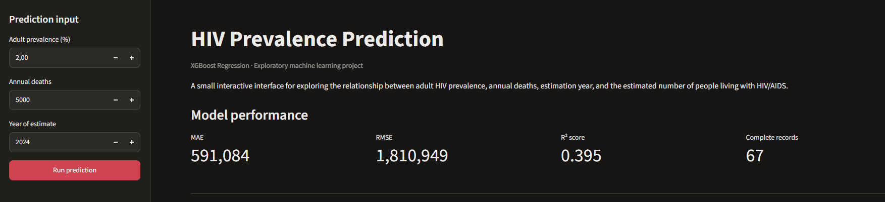

# HIV Prevalence Estimation with XGBoost

[](https://xgboost-hiv-study.streamlit.app/)

A regression project exploring how machine learning can be used to estimate the number of people living with HIV/AIDS based on epidemiological indicators.

## Live Application

[**Launch the interactive dashboard →**](https://xgboost-hiv-study.streamlit.app/)



## Overview

This project explores the use of **XGBoost Regression** to estimate the number of people living with HIV/AIDS using three input variables:

- Adult HIV prevalence
- Annual deaths from HIV/AIDS
- Year of estimate

The work covers data preparation, model training, evaluation, and deployment through an interactive Streamlit application.

## Model

| Component | Description |
|---|---|
| Algorithm | XGBoost Regressor |
| Input features | Adult prevalence, annual deaths, year |
| Prediction target | Number of people living with HIV/AIDS |
| Estimators | 100 |
| Learning rate | 0.1 |
| Maximum depth | 5 |
| Random state | 42 |
| Evaluation metrics | MAE, RMSE, R² |

The trained model and preprocessing pipeline are saved together using Joblib, allowing the application to load the same pipeline for inference.

## Project Structure

```text
xgboost-hiv-study/
├── app.py
├── train_model.py
├── hiv_prevalence.csv
├── XGBoost_Regression.ipynb
├── requirements.txt
├── model/
│   ├── metrics.json
│   └── xgboost_pipeline.joblib
└── assets/
    └── dashboard.png
```

## Run Locally

Clone the repository:

```bash
git clone https://github.com/haninhammoud01/xgboost-hiv-study.git
cd xgboost-hiv-study
```

Create and activate a virtual environment:

```bash
python -m venv .venv
```

On Windows:

```powershell
.venv\Scripts\activate
```

On macOS/Linux:

```bash
source .venv/bin/activate
```

Install dependencies and run the application:

```bash
pip install -r requirements.txt
streamlit run app.py
```

To retrain the model:

```bash
python train_model.py
```

## Notes & Limitations

This project is intended for educational and exploratory purposes. The dataset contains incomplete observations and records from different estimation years, which may affect model performance and generalization.

The predictions should not be interpreted as official HIV statistics, clinical assessments, or a basis for public-health decisions.

## Tech Stack

`Python` · `Pandas` · `NumPy` · `Scikit-learn` · `XGBoost` · `Joblib` · `Streamlit`

---

**Author:** [Hanin Hammoud](https://github.com/haninhammoud01)
